# MMTX · MultiMedia Transfer

A desktop app for getting footage off camera cards and onto archive drives, and Google Photos takeouts into a dated photo library, without ever wondering if a file made it. Every file is checksummed on the way in, read back from the destination disk, and compared. If MMTX says it's done, it's bit-perfect.

The **MMTX Library** companion app then lets you browse all of it like Google Photos: every shoot day on one scrolling page, hover a clip to scrub through it, search, play, and pull files out into a project. See [MMTX Library](#mmtx-library).

Inspired by [mmt](https://github.com/konradit/mmt) and [GPTransfer](https://github.com/omokage-code/GPTransfer). See [Acknowledgements](#acknowledgements).


| Live transfer | Archive | Verify |
|---|---|---|
|  |  | 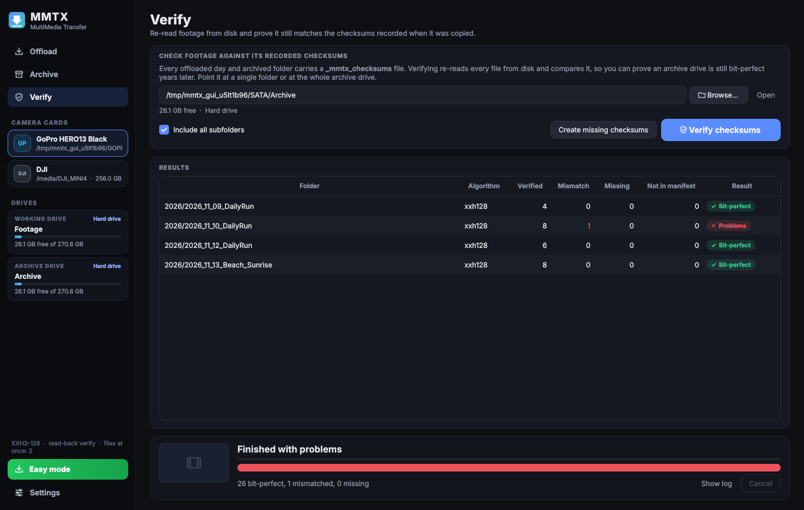 |

*(Screenshots use generated test clips.)*

## Easy mode

For anyone who just wants their videos saved: one step at a time, big type, and exactly one thing to click. Switch with the **Easy mode** button at the bottom of the sidebar, and back with **Advanced** in the corner. MMTX remembers which one you used last.

| 1. Connect | 2. Choose folder (once) | 3. Name it and start |
|---|---|---|
| 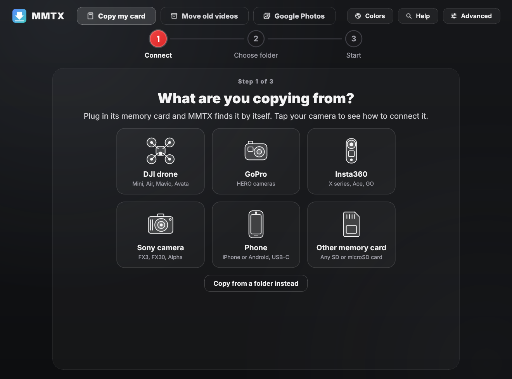 | 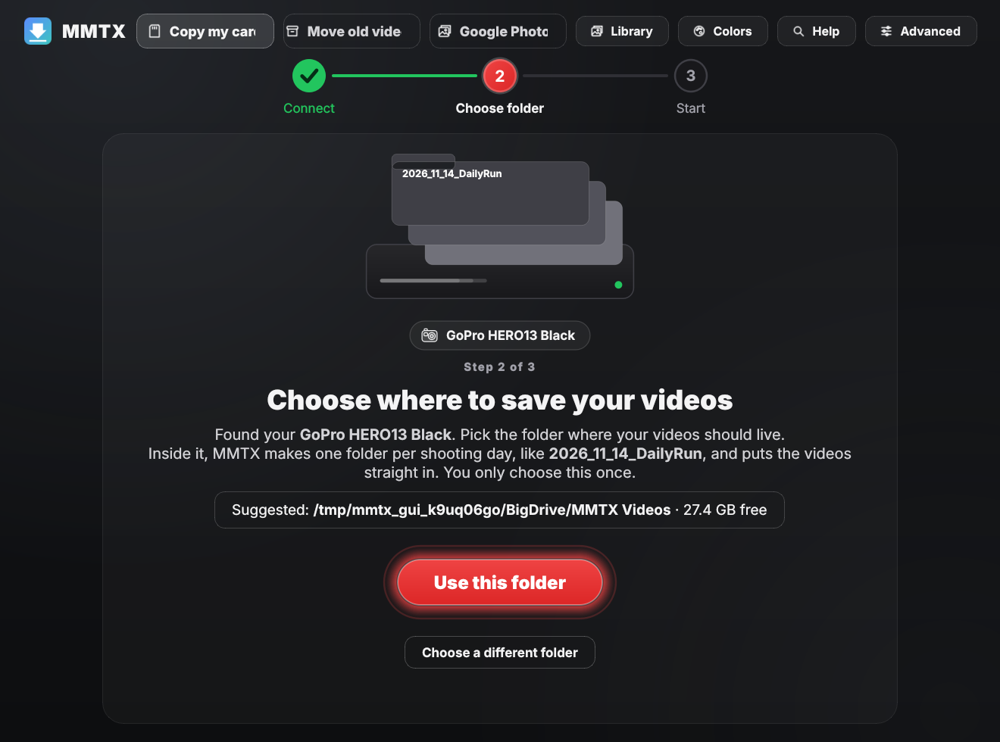 | 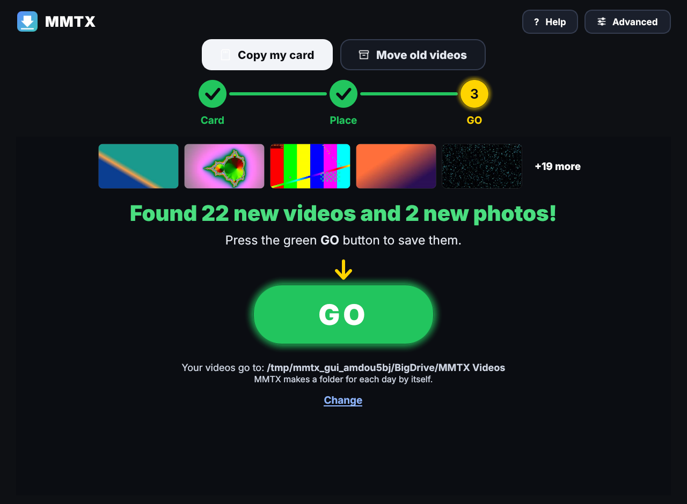 |

- **What are you copying from?** Step 1 shows a tile per device type: DJI drone, GoPro, Insta360, Sony camera, Phone, Other memory card (original device icons, not the makers' logos). Plugging in a card or camera is still enough on its own: MMTX finds it. Tapping a device shows how to connect that exact device, with a **Memory card** route and a **USB-C cable** route, written for the computer you're on:

  | GoPro | Sony | Phone |
  |---|---|---|
  | 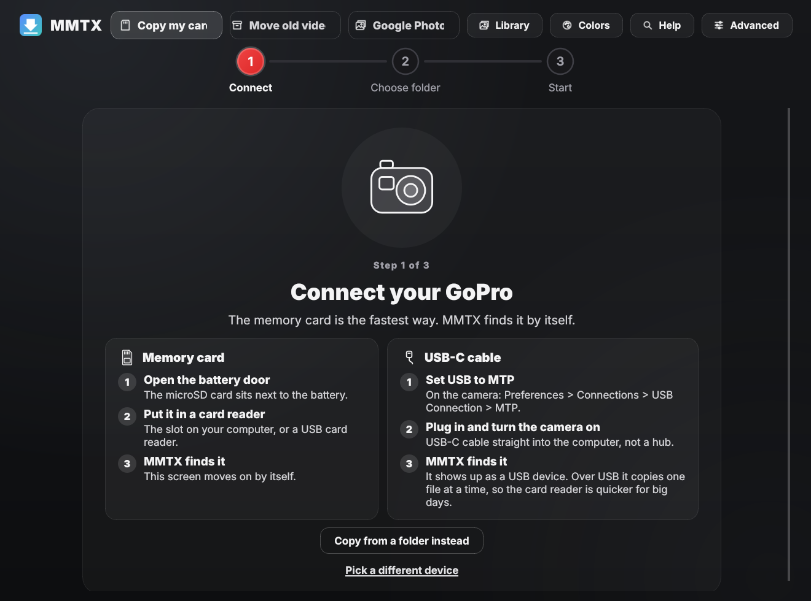 | 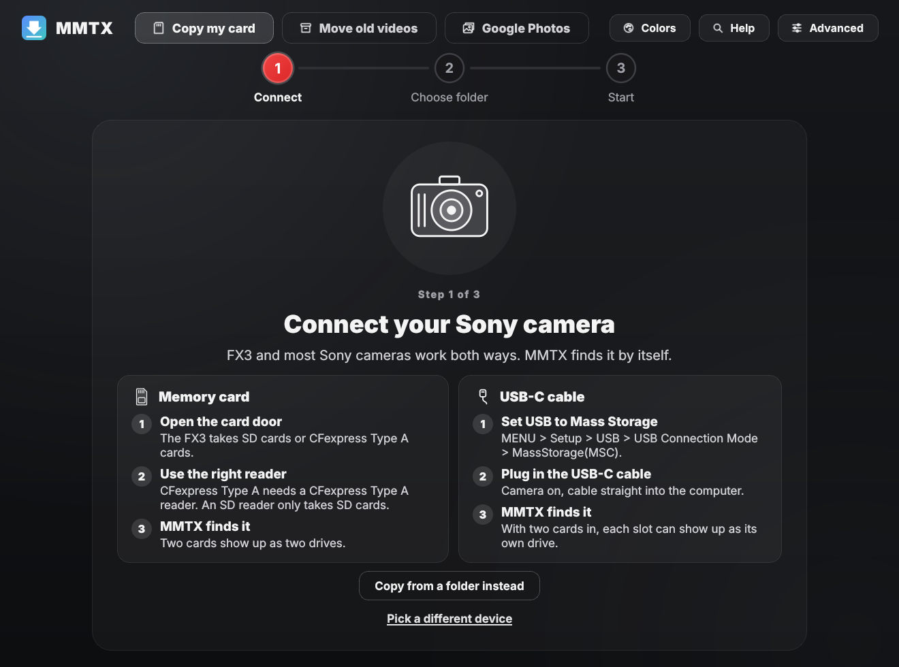 | 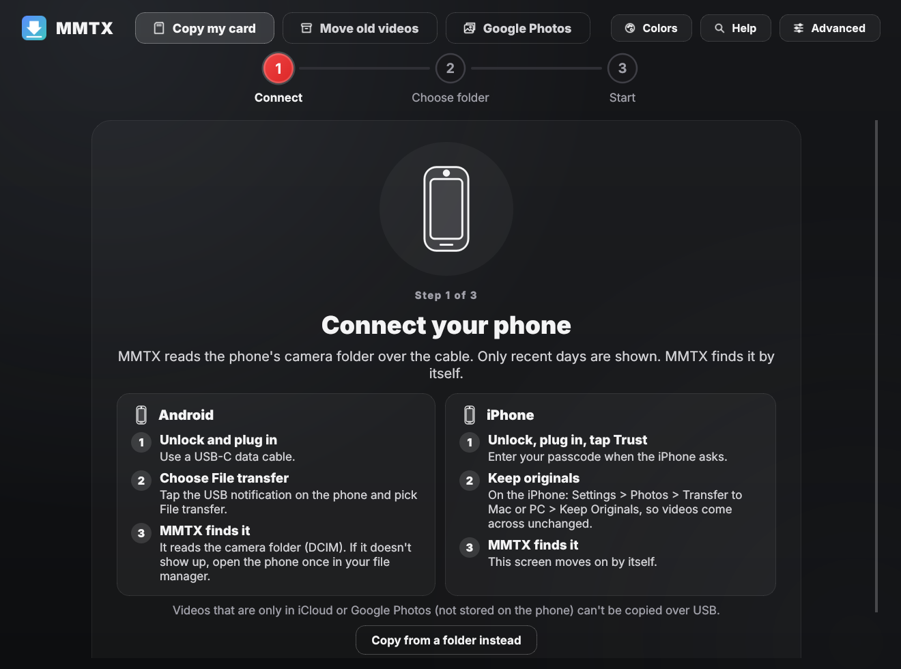 |

  The camera settings come from each maker's own instructions: GoPro *Preferences > Connections > USB Connection > MTP*; Sony FX3 *MENU > Setup > USB > USB Connection Mode > MassStorage(MSC)* (and CFexpress Type A needs its own reader); Insta360 *File Transfer* (X4/X5/X6) or *U-Disk Mode* (X3); DJI drones plugged in while off; Android *File transfer*; iPhone *Trust* plus *Settings > Photos > Transfer to Mac or PC > Keep Originals* (Windows also needs Apple's *Apple Devices* app).
- **Name this shoot.** The Start screen has a name field, pre-filled with your default title and selected, so typing replaces it: `Beach Run` makes `2026_11_14_Beach_Run`. Every new day on the card gets that name with its own date; a day that already has a folder keeps it and new files join it. Under **Choose which ones**, each day has its own name field (e.g. Nov 13 becomes `2026_11_13_Hike`). An empty name falls back to the default, so a folder is never just a date.
- **The device is shown** as a chip above the title once it's read ("GoPro HERO13 Black", "Pixel 8 · over USB").

**Colors mean the same thing everywhere:**

| Color | Meaning |
|---|---|
| Red, flashing | The button for the step you still have to do. Press it and it turns green, the tracker ticks the step off, and the next step opens. |
| Blue, pulsing | Copying right now. A rotating hourglass sits in a progress ring on the clip (and on the big "Now" picture). |
| Orange, flashing | Almost done (the last 20% of copy + check). |
| Green | Done: a large check on the clip. Its outline flashes green for 3 seconds, then stays solid. |
| Grey | Waiting, or not chosen. |

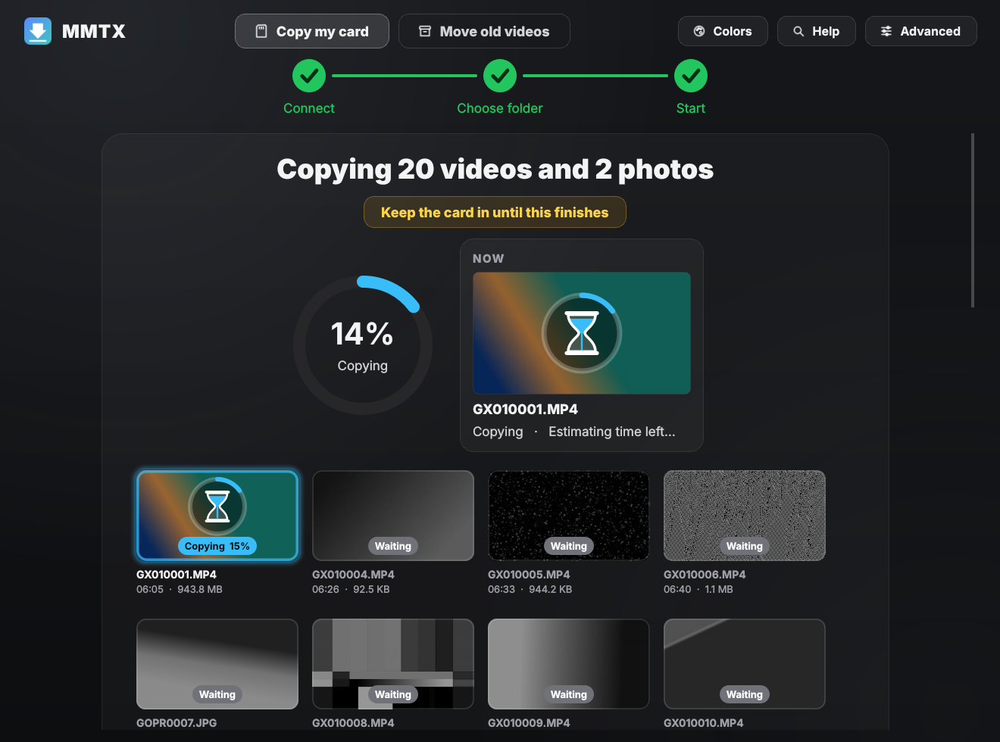

- **Copy everything or choose which ones.** Step 3 has a big **Copy everything** button and a **Choose which ones** button. Choosing shows every clip on the card by day: tap to add or remove, **All/None** per day, **Only new ones**, and a running count. Clips already on your computer are tagged **Saved**.
- **Delete from the card, if you want.** In **Choose which ones**, switch on **Delete them from the card after copying**. Each chosen clip is deleted only after its copy checks out, and if anything from a day fails, nothing from that day is deleted. You confirm once before it starts. **Copy everything** never deletes.
- **Move old videos** works the same way: **Move all** or **Choose which ones** (a list of day folders, older ones pre-chosen), with a switch for removing them from this computer after the check. Folder rows show the same hourglass, orange and green states while they move.
- **Choose which ones** and the delete switch:

  | Choose | Delete switch |
  |---|---|
  | 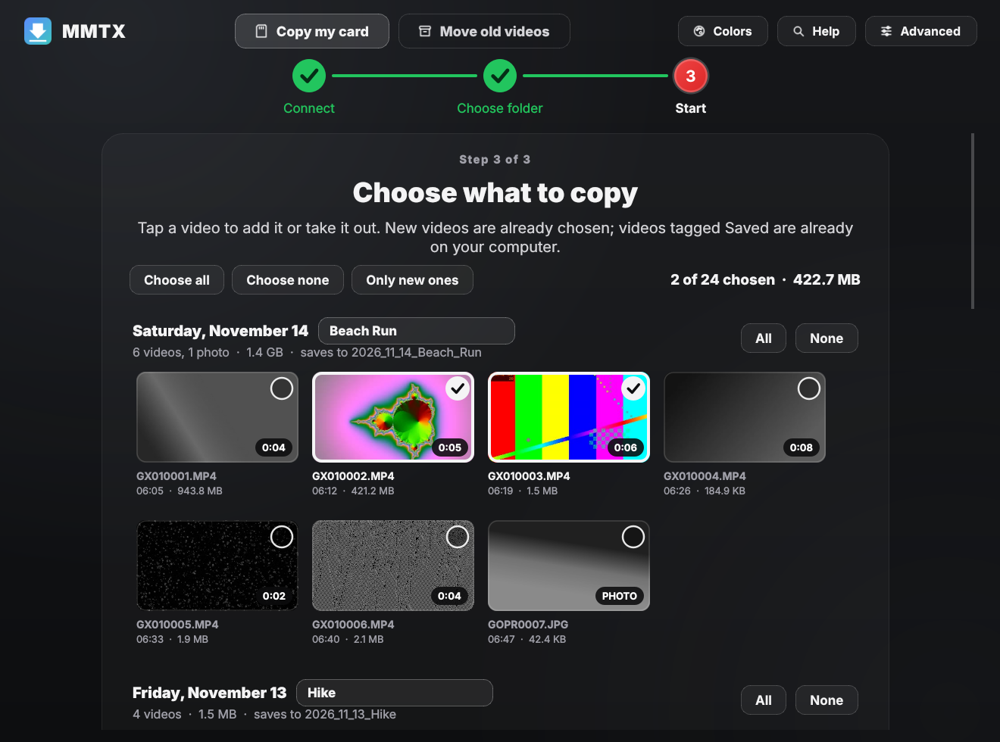 | 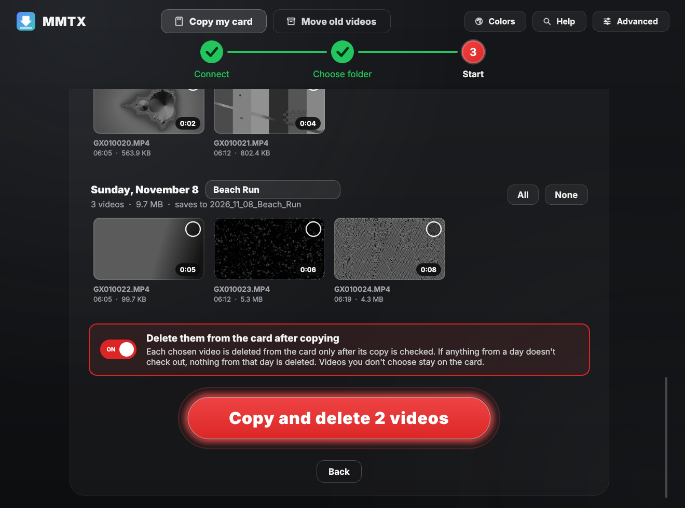 |

- **Colors** (top bar) offers four palettes, also in Settings. All of them are neutral, so the five status colors stand out:

  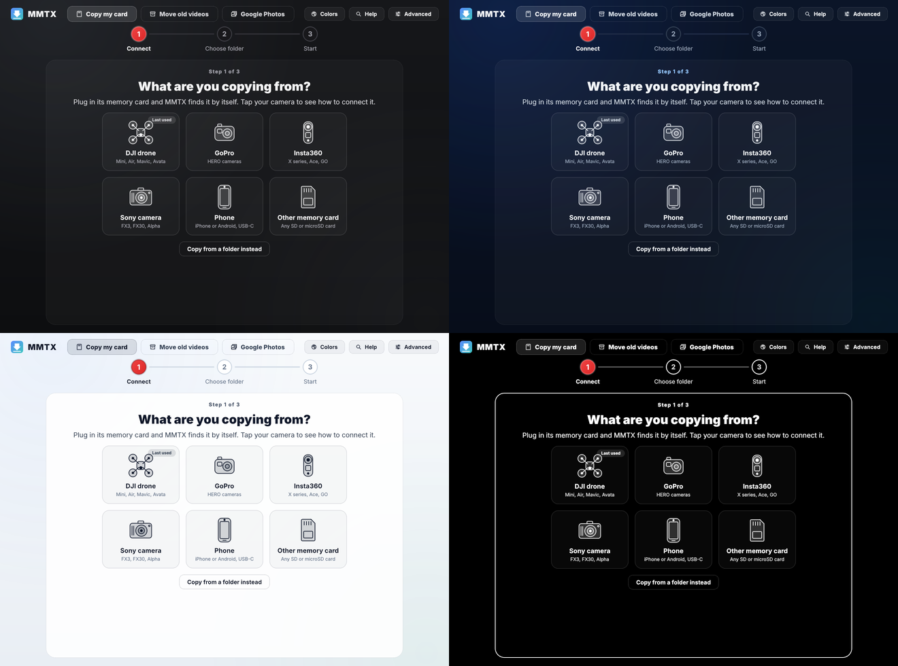

  **Graphite** (default, neutral charcoal), **Midnight** (navy, no purple), **Daylight** (light background, dark text), **High contrast** (black and white, bold outlines).
- **Help** answers the real questions: a card that doesn't show up, where videos are saved, when it's safe to remove the card, what "checked" means, pressing Start twice, freeing up space. **Show me around** walks through the screen with Back/Next.
- Problems get plain-language popups ("The card was removed too early. Put it back in and press Start again.") with the technical details one click away.

**Easy and Advanced are two views of the same session.** The card scan and any running transfer belong to the app, not to a page. Start a copy in Easy mode, switch to Advanced, and the Offload page shows the same clips live. Start an archive and the Archive page shows each folder as Waiting, Copying 7/13, Moved. Folders and settings chosen in one show up in the other.

**Advanced uses the same status graphics:** grey waiting tiles, a blue pulsing outline with a rotating hourglass in a progress ring while a clip copies, orange "Almost done", and a large green check with a green outline when it's saved. Archive rows get the same overlay on their poster plus a status pill with the hourglass or check. Cards in the sidebar and the page header show the device icon (drone, action cam, 360, cinema camera, phone, card).

| Advanced offload | Advanced archive |
|---|---|
|  | 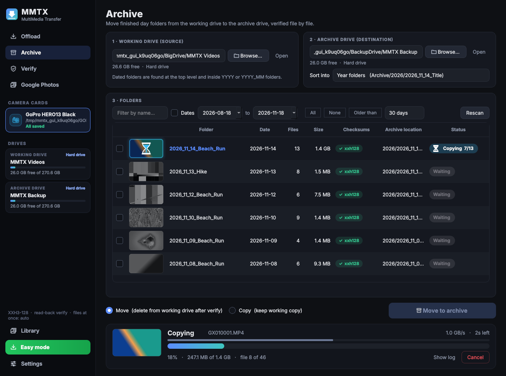 |

## Several cards and devices at once

Plug in everything from a shoot: the GoPro card, the drone card, the FX3's cards, your phone. MMTX reads each one in the background as it shows up and keeps the result, so every device has its own live status and switching between them is instant.

| Easy: All devices | Copying all of them |
|---|---|
| 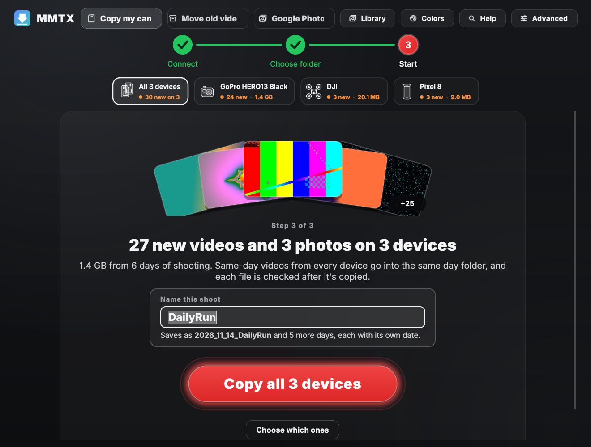 | 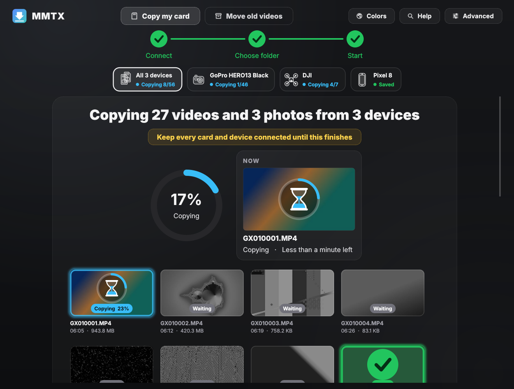 |

- **Each device says where it stands:** *Reading…*, *24 new · 1.4 GB*, *Copying 4/7*, *Saved*, *All saved*. In Easy mode on the chips above the steps, in Advanced on the card tiles in the sidebar.
- **Easy mode:** with two or more connected, a switcher appears: **All N devices** plus one chip per device. *All* shows everything that's new across them with one name for the shoot and **Copy all N devices**. Tap a device to see and copy just that one. **Choose which ones** works across all of them (one section per device, one name per day).
- **Advanced:** click a card in the sidebar to show it (no re-read). **Offload all N cards** copies this card's selected days with their titles, plus the new days of every other card with the default title.
- **One day, one folder:** same-day files from every device land in the same `YYYY_MM_DD_<Title>` folder with one checksum file. If two cameras used the same file name (two GoPros both have `GX010001.MP4`), both are kept (`GX010001_1.MP4`).
- **Side by side:** the devices are copied at the same time, each within its own limit (a card reader 2 files at once, a phone 1), so two card readers on separate ports roughly double the speed. Every file is still read once while hashed, written, read back and compared.
- After the copy, every device involved is re-read and switches to *All saved*. Pull a card and another one takes over the screen.

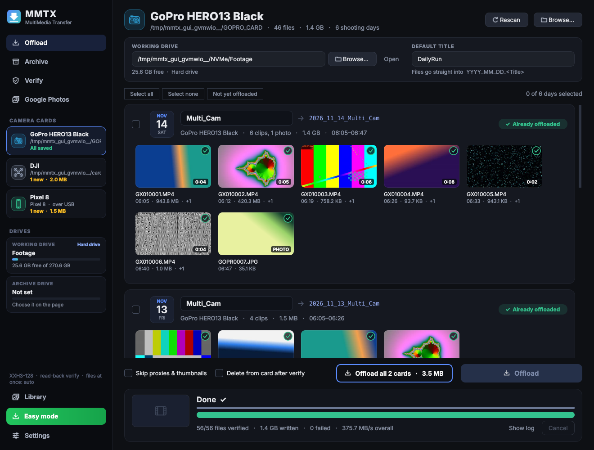

## Phones and cameras over USB

Phones, and GoPros connected by cable, use MTP: they show up in Explorer under *This PC* but have no drive letter, so nothing can open their files directly. MMTX reads them anyway:

- **Windows:** through Windows Portable Devices (the same API Explorer uses), via `comtypes`. Phones, iPhones, GoPro over USB and cameras left in MTP mode all appear as cards in the sidebar and in Easy mode.
- **Linux:** the desktop already mounts them under `/run/user/<uid>/gvfs`; MMTX lists those mounts as cards.
- **macOS:** no built-in MTP. Use the memory card, or import with Image Capture (iPhone) / OpenMTP (Android) into a folder and use *Copy from a folder*.

Copying from a USB device works exactly like a card: each file is read once while it's hashed, written, read back from the destination, and compared. Differences: one file at a time (MTP devices misbehave with parallel reads), only the camera folder (`DCIM`) is read, phones show the last 30 days by default (*Settings > Phones*), and thumbnails show the device icon instead of a frame, because making one would mean pulling the whole clip over the cable. *Delete from card* works too: a file is removed from the phone only after its copy checks out.

The Windows device code follows Microsoft's documented WPD calls and is covered by tests through a simulated device, but it hasn't been run against a real phone yet. If a device doesn't show up, the log says why, and the memory card route always works.

## Google Photos takeouts

The **Google Photos** page (and the third tab in Easy mode) turns [Google Takeout](https://takeout.google.com) zips into a plain folder library you own:

```
Photos/
  2026/2026_01/2026_01_22/IMG_6367.HEIC
                         /_google_photos.json        captions, places, people, albums, Google's link
                         /_mmtx_checksums.xxh128      like every MMTX folder: Verify works on it
  Unknown date/                                       nothing anywhere said when it was taken
  _albums.json                                        album -> files (photos are stored once, not per album)
  _mmtx_library.db                                    index of every photo's checksum
```

On Takeout, deselect everything, tick Google Photos, keep the .zip format, download every part. Put the zips (and any loose `.MOV` files you saved from Google) in one folder, add that folder (button, or drag it onto the window) and pick the library folder. That's it. The takeout folder can even sit inside the library folder: the library's own year folders are never read back in.

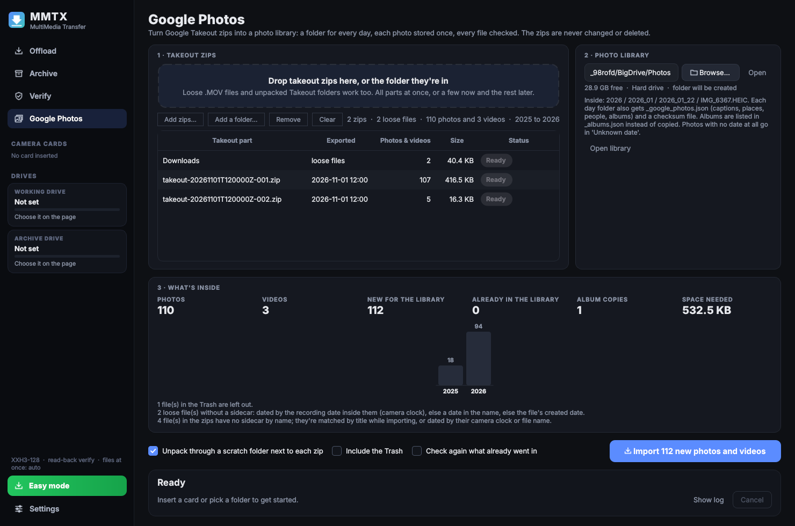

| Easy mode | Importing | Next year's takeout |
|---|---|---|
| 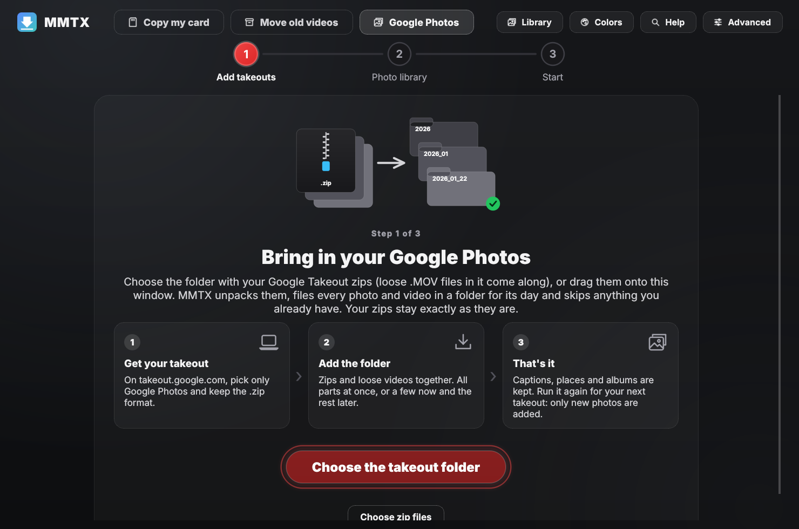 | 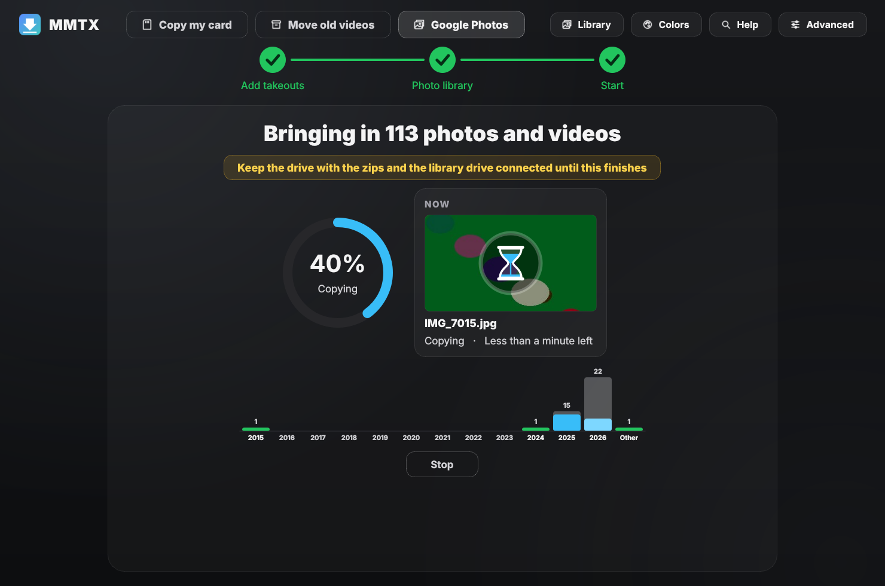 | 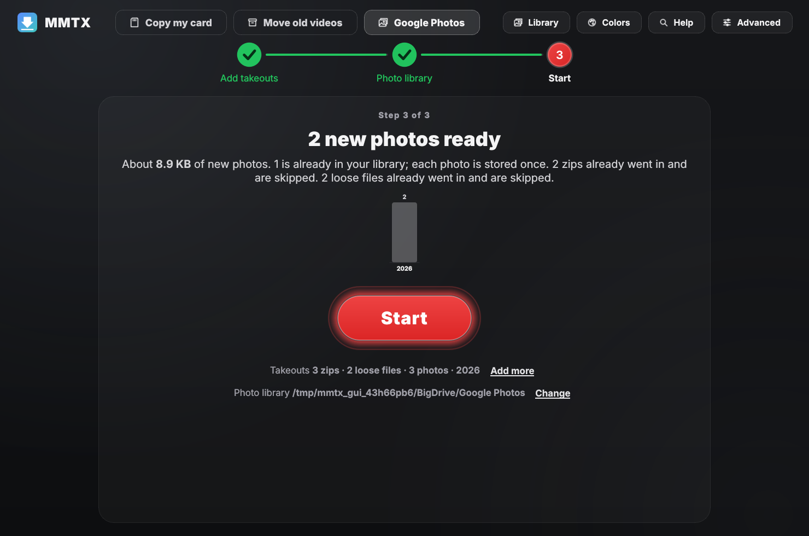 |

What it handles for you:

- **Multi-part exports.** Only each zip's file list is read up front, so planning takes seconds even for 50 GB parts. A photo in part 001 still finds its sidecar in part 002. Missing parts are pointed out, and you can add them later: photos that went in without their details get them, and move to the right day, when the part with their sidecar shows up.
- **Takeout's sidecar names.** `IMG.jpg.json`, `IMG.jpg.supplemental-metadata.json` and every cut-off variant of it (`.supplemental-meta.json`, `.suppl.json`...), names cut at Takeout's 46/51 character limit, `(1)` moved behind the extension (`IMG.jpg(1).json` belongs to `IMG(1).jpg`), `-edited` copies that share the original's sidecar, Live Photo videos that have none of their own, and a last resort match on the `title` inside the JSON.
- **Loose files next to the zips.** Photos and videos sitting loose in the folder go in with everything else. Loose files that went in are remembered by path, size and modified time, so the next run skips them; change one and it's looked at again.
- **The right day.** Google's `photoTakenTime` is what Google Photos shows (including dates you fixed there), but it's UTC. When the camera's own clock describes the same moment (EXIF in a photo, the recording date inside a video), its local date decides the folder, so a photo taken at 7:30 in the morning in Tokyo isn't filed under the previous day just because it was still the evening before at home. When the two disagree by more than a time zone, you changed the date in Google Photos, and Google's date wins. No sidecar: the camera clock (for an iPhone `.MOV`, Apple's creation date with its time zone, else the movie header's UTC time), then a date in the file name (`PXL_20250704_...`, `IMG-20190623-WA0001`), then the upload date, then, for loose files, the file's created date (the earlier of created and modified, since copying a file resets created but keeps modified). The file date comes last on purpose: a file that came out of a takeout is "created" the day you downloaded or unzipped it, while the date inside the video is the day you filmed it. The summary says how many files had to fall back to it.
- **File dates in the library** are set to the moment the photo or video was taken: modified everywhere, and created too on Windows, so sorting by date in Explorer sorts by shooting date.
- **Each photo stored once.** Takeout puts album photos in twice (year folder and album folder), and every new takeout contains everything again. MMTX checksums each file as it comes out of the zip; anything the library already has is only read, never written, and its album membership and details are merged. Running the same zips again is instant: completed zips are remembered.
- **Originals untouched.** The photos are written byte for byte as they are in the zip, read back from the library drive and compared, then renamed into place. Nothing is rewritten inside them; Google's details go in the per-day `_google_photos.json` (which is itself in the checksum file, so Verify covers it). Nothing in the library is ever overwritten: if a file with that name is already in the day folder, MMTX compares checksums. The same file means there's nothing to copy; a different file means both are kept (`IMG_0001.jpg`, `IMG_0001_1.jpg`). The final rename itself refuses to replace anything, even if a file appears at that name mid-import.
- **Your zips and loose files are never changed or deleted.** With *Unpack through a scratch folder* on (the default), each zip gets `_mmtx_unpack_<zip name>` next to it: a photo is unpacked there, moved into the library and deleted from scratch straight away, and the folder is removed when that zip is done. On the same drive the move is a rename, so it costs nothing; if the zips sit on another drive than the library, each new photo is written twice (scratch, then library). Turn the option off to stream straight from the zip into the library instead.
- **Left out:** the Trash folder (tick *Include the Trash* to keep it) and anything from other Google products in the same export.
- Delete a photo from the library and tick *Read zips again*: it comes back.

Google's own API isn't used: since March 2025 it can only list photos an app uploaded itself, and its video downloads are re-encoded copies. Takeout gives you the originals.

## MMTX Library

A Google Photos style browser for everything MMTX puts on disk: the working drive, the archive drive and the photo library. It runs next to MMTX or on its own. Open it with the **Library** button (MMTX's sidebar, or the top bar in Easy mode), `run_library.bat` / `./run_library.sh`, `MMTX.exe --library` (the build also makes an `MMTX Library` starter), or `python -m mmtx.library [folder]`.

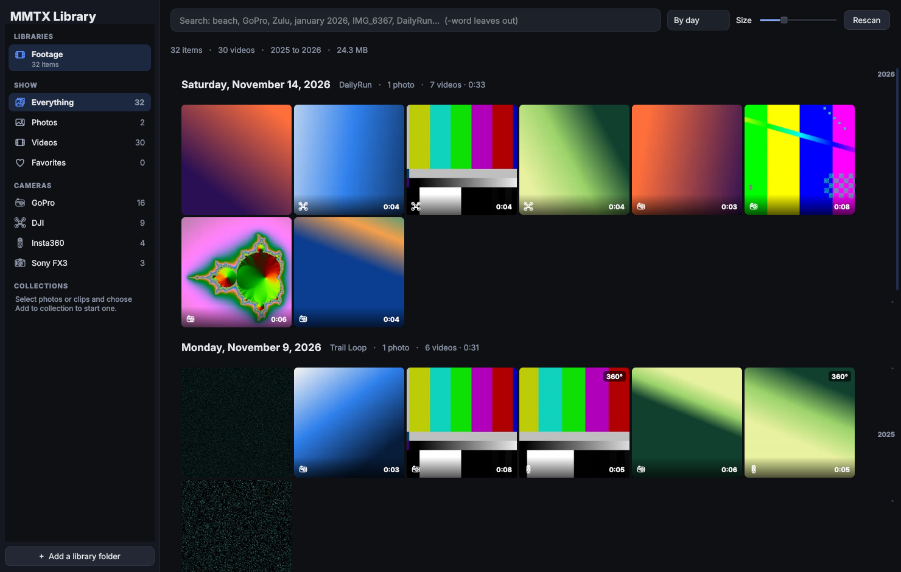

| Hover a clip to scrub through it | Photos, by month | Search |
|---|---|---|
| 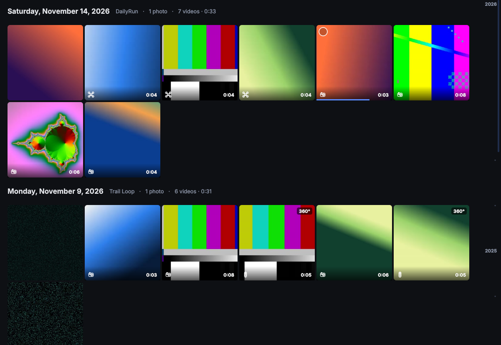 | 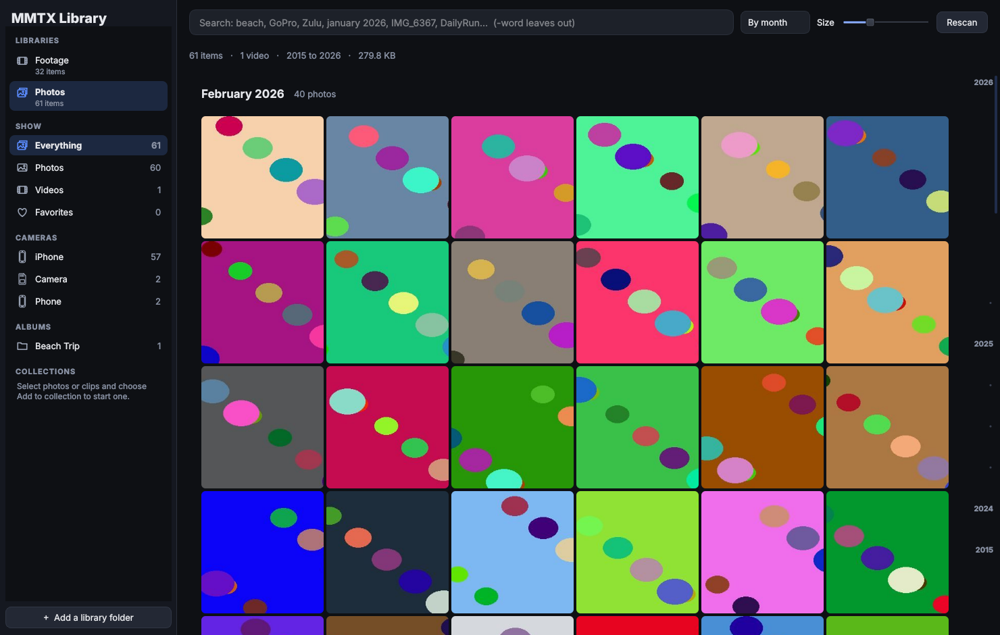 | 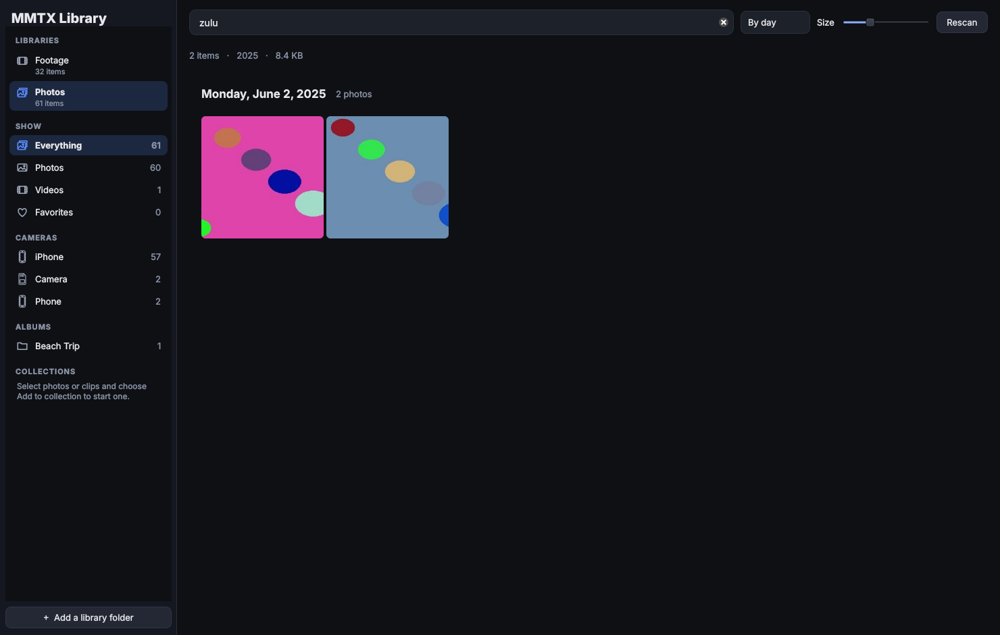 |

### Looking through footage

- **Every shoot day on one page.** A section per day folder with its title, photo and video counts and total running time, newest first. The scrubber on the right jumps between years. *By month* groups sparse days together (better for phone photos). Tile size: the slider or Ctrl+wheel.
- **See what's in a clip without opening it.** Move the mouse across a video tile and it scrubs through 8 frames of the clip; the line along the bottom shows where you are. Frames come from the camera's low-res proxy when there is one (GoPro and Insta360 `.LRV`, DJI `.LRF`, Sony `SUB`), so even 5.3K HEVC is quick. Made once per clip (see [Previews](#previews-made-once)).
- **Badges:** duration, which camera (GoPro, DJI, Insta360, Sony, phone), 360°, RAW, a heart for favorites.
- **Double-click to open.** The clip's preview fills the screen straight away and the video takes over as soon as it's playing, muted (*Sound on* to hear it). Clips with a camera proxy start on that *Low-res copy*: it opens at once and stays smooth from a slow archive drive. Untick it for the full-quality file, at the same moment in the clip; the choice is remembered. Photos, including HEIC and RAW previews, fit the window: wheel to zoom, drag to pan, double-click for 100%. The info panel shows when it was taken and where that date came from, camera, size, caption, place (with a maps link), people, albums, collections, the Google Photos link, the path and the checksum. Keys: ← → previous/next, Space play/pause, F favorite, I info, Esc back.
- **Sidebar:** your libraries, Everything / Photos / Videos / Favorites, Cameras by model (read from the card's own files: GoPro `version.txt`, Sony XML, Insta360 `.insv`, iPhone from Takeout), Google Photos albums, and your collections.
- **Search** matches every word you type against the file name, shoot title, folder, camera and model, the date (`2026-11-14`, `november 2026`, `nov`), Google captions, people, albums and original names, plus `photo`, `video`, `360` and `raw`. A word with a minus leaves things out: `gopro -dailyrun`.

### Taking files into a project

Select (click, Shift-click for a range, Ctrl-click, click a day's header for the whole day, Ctrl+A), then:

- **Drag** the selection straight into Premiere, Resolve, Explorer or Finder. That hands over the files themselves; nothing is copied.
- **Export...** copies them to a project folder, either flat or in day folders (`2026_11_14_DailyRun/`), keeping the names or putting the date in front (`2026_11_14_GX010001.MP4`).
- **Add to collection** keeps a named set (an edit, a client, a highlight reel) you can come back to and export again.
- **Favorite** and **Copy paths**.

Export works like every other MMTX copy: each file is read back and compared, file dates are kept, and a checksum file is left in each destination folder so Verify works on the project too. Nothing in the destination is overwritten: a file with the same name and the same checksum is skipped, a different one is saved as `name_1.ext`.

The Library never moves, renames or deletes anything in a library. Favorites and collections are stored in the catalog, not in your files.

### Catalogs

Each library folder holds one catalog file, `_mmtx_library.db` (the same file the Google Photos importer keeps its index in). Indexing only reads file headers: duration, resolution, camera and date. Checksums come from the `_mmtx_checksums` files MMTX already wrote, so nothing gets hashed again. Rescans are incremental by path, size and modified time: unchanged files are only listed, never opened. Opening a library checks it quietly in the background, and that check only reads day folders whose contents changed since last time (one look per folder, not per file), so even a big archive opens instantly. *Rescan* checks every file.

MMTX keeps catalogs current by itself: when an offload, archive or takeout import finishes, the day folders it touched are indexed in the background, and *Move to archive* drops the moved folders from the working drive's catalog. You only need *Rescan* after changing folders by hand.

Day folders are found up to four levels down, in any of these layouts, so any footage organized by day can be added as a library, not just MMTX's:

```
YYYY_MM_DD_Title/                 working drive (Offload)
YYYY/YYYY_MM_DD_Title/            archive, year folders
YYYY/YYYY_MM/YYYY_MM_DD_Title/    archive, year and month folders
YYYY/YYYY_MM/YYYY_MM_DD/          Google Photos library
Unknown date/
```

### Previews made once

Every photo gets a thumbnail and every clip a thumbnail plus its 8-frame hover strip. They're made once, kept in one file on this computer, and from then on the grid fills straight from it: reopening a library shows every visible tile in well under a second, without touching ffmpeg.

- **In the background.** When a library opens, MMTX Library makes whatever previews are missing for every connected library, the open one first, newest days first. The card at the bottom of the sidebar shows how far along it is and roughly how long is left; *Pause* keeps what's done and picks up where it stopped. What you're looking at always comes first: tiles on screen are made straight away and the background work waits for them, and anything you scroll past before it's made is dropped instead of holding up the tiles you stopped on.
- **Right after each offload.** MMTX makes the new clips' previews as soon as an offload or a Google Photos import finishes, while the files sit on the fast working drive. It waits whenever a copy is running. (Settings: *Make Library previews right after each offload and import*.)
- **They follow the files.** Previews are keyed by the checksum MMTX recorded for each file, not by where it is. When a shoot moves to the archive drive, the archive's catalog finds every preview already made.
- **Cheap to make.** A clip takes one ffmpeg run that seeks straight to 8 keyframes and decodes only those, from the camera's proxy when there is one. iPhone HEICs use the preview Apple stores inside the file (milliseconds instead of a full 12 MP decode). Damaged files are noted once and not retried.
- **Size:** about 20 to 30 KB per photo and 60 to 100 KB per clip (more detail compresses less), so 15,000 clips take 1 to 1.5 GB. Right-click a library, *Clear all previews* to start over.

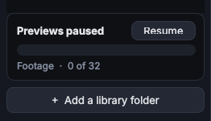

**Offline.** A copy of each catalog and all the previews stay on the computer (`%APPDATA%\MMTX\libraries` and `%LOCALAPPDATA%\MMTX\cache\previews.db` on Windows). Unplug the archive drive and you can still browse and search it with every picture showing; opening, playing and exporting wait until it's back. On Windows it's found again under a different drive letter too (each library has its own ID).

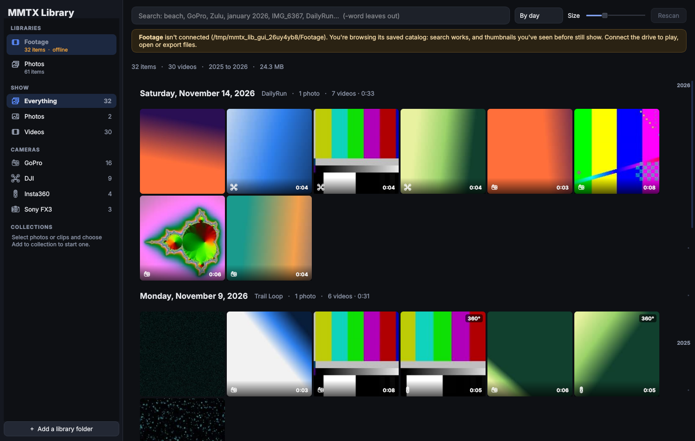

## What it does

| Page | From → To | Grouped by |
|---|---|---|
| **Offload** | SD card / camera → working drive (NVMe) | **Shooting date** → `YYYY_MM_DD_<Title>` folders, with a thumbnail of every clip |
| **Archive** | Working drive → archive drive (SATA) | **Folder**, sorted into `Archive/YYYY/` (or `YYYY/YYYY_MM/`, or flat) |
| **Verify** | Any folder or a whole archive drive | Re-reads everything and compares against the recorded checksums |
| **Google Photos** | Google Takeout zips → photo library | **Day the photo was taken** → `YYYY/YYYY_MM/YYYY_MM_DD/` |
| **Library** | Any of the above | Browse, scrub, search, play, export, collections. Read-only, works offline |

## Quick start

**Windows:** double-click `run_mmtx.bat` (the Library on its own: `run_library.bat`). First launch creates a local `.venv` and installs PySide6, xxhash, imageio-ffmpeg, Pillow and pillow-heif (needs Python 3.10+).

**Linux / macOS:** `./run_mmtx.sh` (Library: `./run_library.sh`)

**Or:** `pip install .` and then run `mmtx` or `mmtx-library`

**Standalone .exe (no Python on the target PC):** run `build_exe.bat`, which produces `dist\MMTX\MMTX.exe` and an `MMTX Library.bat` starter next to it (ffmpeg and the HEIC decoder are bundled).

## Daily workflow

1. **Plug in the card** (or several: each gets a sidebar tile with its own status, click one to show it). It shows up in the sidebar within a few seconds and Offload opens it: one card per shooting day, with a thumbnail, duration and time for every clip. Days that aren't on the working drive yet are pre-selected. Clips already on the working drive carry a hollow green check. Double-click a tile to play the clip.
2. **Set titles.** The default title (e.g. `DailyRun`) fills every day. Type in a day's title box to change just that day (`Beach Sunrise` → `2026_11_13_Beach_Sunrise`). If a folder for that date already exists on the working drive, its title is picked up automatically and new files merge into it.
3. **Click Offload.** Each tile shows a progress ring while it copies and verifies, then a solid green check. The transfer bar shows the clip in flight. The summary lists copied / already there / failed, plus copy and read-back speeds.

When you're done editing:

4. **Archive** → pick the working drive and the archive drive → **Older than 30 days** (or tick folders, or filter by date range) → **Move to archive**. Each folder is copied, verified against both its fresh hash and the checksum recorded at offload, and only then removed from the working drive.

Months later: **Verify** → point it at the archive drive → **Verify checksums**. You get a per-folder report: bit-perfect, rotted, missing.

## Speed: why not always copy 4 files at once?

Copying several files at once only helps when the drives have headroom a single stream doesn't use. The time goes into two passes over the destination: writing every byte, then reading every byte back to verify it. Hashing isn't the bottleneck (XXH3 runs at ~15 GB/s per core and releases the GIL).

| Route | Bottleneck | Parallel effect |
|---|---|---|
| SD card → NVMe | The card (90-300 MB/s). NVMe read-back is ~10x faster | 2 at once hides the read-back behind the next copy: small win |
| NVMe → SATA SSD | SATA link (~550 MB/s) is shared by the write *and* the read-back | Little to gain; the link is already full |
| NVMe → hard drive | Seek time | **Slower**: the heads bounce between files and files fragment |
| NVMe → NVMe | Nothing much | Real win: read-back fully overlaps writing |
| Lots of small files (photos, LRV/THM/SRT) | Per-file overhead (create, fsync) | Real win on flash |

So **Files at once = Auto** (Settings) detects the drive types (Windows: bus type + seek penalty; Linux: `/sys/block`; macOS: `diskutil`) and picks:

- **1** if either side is a hard drive, a USB drive of unknown type, or can't be identified
- **2** from an SD card or USB reader to flash
- **3** between flash drives

The working and archive drive tiles in the sidebar show what was detected. You can force 1-4 in Settings.

After every transfer the summary shows **Copy speed per file** and **Read-back speed per file** next to the overall speed, so you can see which pass is the limit on your hardware. To measure your own drives directly:

```
python tests/bench.py D:\bench_src F:\bench_dst
```

Measured in the build VM (cloud SSD, so treat these as relative):

| | 1 at once | 2 | 3 | 4 |
|---|---|---|---|---|
| 6 × 256 MB clips | 1.00x | 1.23x | 1.29x | 1.24x |
| 1500 × 64 KB files | 1.00x | 1.33x | 1.47x | 1.56x |

## Thumbnails

Thumbnails are generated in the background, cheapest source first:

1. Sony's ready-made `THMBNL/C0001T01.JPG` (640×360)
2. A keyframe from the low-res proxy: GoPro / Insta360 `.LRV`, DJI `.LRF`, Sony `SUB/…S03.MP4`
3. A keyframe from the full clip (keyframe-only decode, so even 5.3K HEVC is quick)
4. GoPro `.THM`, photos directly, RAW files via their embedded preview JPEG

Durations are read straight from the MP4 header. Thumbnails are cached on disk (`%LOCALAPPDATA%\MMTX\cache`), so reopening a card is instant. They pause automatically while a transfer runs, so they never compete with the copy for the card. Video frames use ffmpeg from your PATH or the bundled `imageio-ffmpeg`. Without ffmpeg, tiles fall back to the camera's own thumbnails or a placeholder. Turn thumbnails off in Settings if you want.

## Folder layout

Files go straight into the day folder. No per-camera subfolders, so paths stay short.

```
D:\Footage\  (working drive)                F:\Archive\  (archive drive, "Year folders")
  2026_11_14_DailyRun\                        2026\
    GX010001.MP4                                2026_11_09_DailyRun\
    GL010001.LRV                                2026_11_13_Beach_Sunrise\
    DJI_20261114063012_0002_D.MP4                 GX010001.MP4 ...
    VID_20261114_062000_00_001.insv               Beach_Sunrise.prproj   <- edit files come along
    C0001.MP4   C0001M01.XML                      _mmtx_checksums.xxh128
    _mmtx_checksums.xxh128
```

If two cameras ever produce the same file name on the same day, nothing is overwritten: the second one is saved as `name_1.ext`. If you'd rather have a subfolder per camera, switch on **Put each camera in its own subfolder** in Settings.

## Supported cameras

| Camera | Card layout recognized | Shooting date comes from |
|---|---|---|
| **GoPro** HERO / MAX | `DCIM/1xxGOPRO`: MP4, LRV, THM, JPG, GPR, WAV, 360 | File timestamp. Model read from `MISC/version.txt` |
| **DJI** drones, Osmo Action / Pocket / 360 | `DCIM/DJI_001`, `DCIM/100MEDIA`, `PANORAMA`: MP4, LRF, SRT, JPG, DNG, OSV | Timestamp in the filename (`DJI_YYYYMMDDhhmmss_…`), else file time |
| **Insta360** X-series, GO, Ace | `DCIM/Camera01`: insv, insp, lrv, mp4, dng | Timestamp in the filename. Model sniffed from the `.insv` |
| **Sony** FX3 / FX30 / A7S III / any XAVC body | `PRIVATE/M4ROOT/CLIP` (+ `M01.XML`), `SUB` proxies, `THMBNL`, `DCIM/100MSDCF` | `CreationDate` in the XML sidecar (ignores a wrong file clock). Model from the XML |
| **Phones** (Android, iPhone) | `DCIM/Camera`, `DCIM/1xxAPPLE`, over USB or from a folder | Timestamp in the filename (`PXL_…`, `IMG_YYYYMMDD_…`, Samsung `YYYYMMDD_hhmmss`), else file time |
| **Anything else** | Media files anywhere on the card | File timestamp |

A clip's proxy, thumbnail and sidecar always land on the same day as the clip, even when recording runs past midnight. Camera junk (`MISC`, `MEDIAPRO.XML`, `STATUS.BIN`, log files) is ignored.

## How verification works

1. Each file is copied to `name.mmtx-partial` while the **source stream is hashed** (XXH3-128 by default).
2. The copy is fsync'd and **evicted from the OS cache** (Linux `posix_fadvise`, macOS `F_NOCACHE`, Windows unbuffered `FILE_FLAG_NO_BUFFERING` read), so the next step reads the actual disk rather than RAM.
3. The destination is **read back and hashed**. A match renames it to its final name. A mismatch deletes it, retries once, then marks the file as failed.
4. A manifest `_mmtx_checksums.xxh128` is written at the root of every day / archive folder. It uses the standard `hash  path` format, so `xxh128sum -c` (or `sha256sum -c` if you pick SHA-256) also works without MMTX.
5. On **archive**, the source hash is also compared to the manifest from offload. That catches corruption that happened on the working drive in between. Folders where that happens are copied but **kept** on the working drive and flagged.

With several files in flight, output names are reserved under a lock, so two card files with the same name (e.g. from `100GOPRO` and `101GOPRO`) can never collide. A full disk or a pulled card stops every worker at its next chunk and cleans up their partial files.

## Safety rules

- **Cards are read-only** unless you tick *Delete from card after verify*. Even then, only days where every file verified are touched.
- **Nothing is overwritten.** If the same name already exists and its checksum matches, the file is skipped and counted as verified (this is how re-running an interrupted offload resumes). If the same name holds different content, the new file is saved as `name_1.ext`.
- **Move = copy + verify + delete.** A folder is removed from the source only after every file in it verified.
- Archive moves on the **same physical drive** are an instant rename.
- **Cancel / pulled card:** in-flight `.mmtx-partial` files are removed. Completed files stay verified and in the manifest, so the next run resumes.
- Checks for **free space** and the **FAT32 4 GB file limit** before starting.
- **Camera timestamps are preserved** on every copied file. Read-only attributes are not carried over.
- Every job writes a full log (Settings → Logs → Open).

## Settings

- **Checksum:** XXH3-128 (default), XXH64, SHA-256, MD5. Folders that already have a manifest keep its algorithm.
- **Read-back verify:** on by default. Turning it off still records source checksums (for later Verify runs) but only checks the destination size. Roughly halves the time on slow archive drives.
- **Bypass OS cache on read-back:** on by default.
- **Files at once:** Auto (by drive type) or 1-4.
- **Per-camera subfolders:** off by default (files go straight into the day folder).
- **Easy mode colors:** Graphite, Midnight, Daylight or High contrast (same as the Colors button in Easy mode).
- **Spaces → underscores** in titles (`Morning Run` → `2026_11_14_Morning_Run`).
- **Keep card folder structure** (for Sony Catalyst Browse, which wants `PRIVATE/M4ROOT/…`).
- **Rename GoPro chapters** so they sort together: `GX010123.MP4` → `GX0123_01.MP4`.
- **Thumbnails** on/off.
- **Library previews** right after each offload and import (on by default).
- **Phones:** how many recent days to show from a phone (default 30, 0 = all).

## Notes

- **USB connections:** see [Phones and cameras over USB](#phones-and-cameras-over-usb). A card reader is still the fastest route for big days.
- **Sony cards:** deleting clips outside the camera leaves its clip database out of sync (the camera will offer to repair it). Formatting in camera is cleaner, so *Delete from card* is off by default.
- Network shares are never auto-listed as cards, but you can still Browse to one as a destination.
- To rename the app, change `APP_NAME` in `mmtx/__init__.py`.

## Tests

```
python tests/test_engine.py           # offload, resume, corruption, conflicts, cancel, archive, bit rot, verify, parallel
python tests/test_media.py            # durations, ffmpeg keyframes (H.264 + HEVC), RAW previews
python tests/gui_smoke.py shots/      # drives the real window headless end to end and saves screenshots
python tests/gui_easy.py shots/       # Easy mode from a fresh install: custom selection + delete, switching to
                                      # Advanced mid-transfer, every palette
python tests/gui_multi.py shots/      # two cards + a phone: background reading, switching, Copy all,
                                      # Offload all cards, unplugging
python tests/test_takeout.py          # Google Photos: every sidecar naming quirk, split parts, album copies,
                                      # time zones, re-imports, parts added later, damaged zips, crash recovery,
                                      # loose .MOVs and their dates, never-overwrite with checksum compare
python tests/gui_photos.py shots/     # Google Photos page and Easy tab end to end, drag and drop
python tests/test_previews.py         # Library previews: one-pass making (rotated, very short, damaged, audio-only),
                                      # HEIC embedded previews, the store, pause / cancel / resume, yielding to
                                      # the screen, no ffmpeg, previews following a Move to archive, quick checks
python tests/test_catalog.py          # Library catalogs: footage drive, archive with Move, saved copy offline,
                                      # photo library search, collections, verified export, never-overwrite
python tests/gui_library.py shots/    # real GoPro / DJI / Insta360 / FX3 clips offloaded and archived, a takeout
                                      # with a HEIC, then the Library end to end: scrub, viewer, export, offline,
                                      # and MMTX indexing its own jobs
python tests/bench.py SRC_DIR DST_DIR # files-at-once benchmark on your own drives
python tests/make_fake_cards.py out/  # fake GoPro / DJI / Insta360 / FX3 cards to play with
python tests/make_fake_takeout.py out/ # a fake two-part takeout with all of Takeout's quirks
```

Set `MMTX_TEST_WORKERS=3` to run the engine suite with 3 files in flight.

## Layout

```
mmtx/
  hashing.py     checksums + cache-bypassing readers (Linux / macOS / Windows)
  manifest.py    _mmtx_checksums.* read / write (xxhsum / sha256sum compatible)
  transfer.py    parallel copy -> read-back verify -> rename engine, move/delete rules, Verify + Create-checksum runners
  drives.py      NVMe / SSD / HDD / SD detection and the Auto files-at-once policy
  media.py       MP4 durations, ffmpeg keyframe grabs, RAW previews, thumbnail source picking
  cameras.py     GoPro / DJI / Insta360 / Sony detection, roles, capture dates, models
  scanner.py     card scan grouped by day; working-drive scan of YYYY_MM_DD_<Title> folders
  planner.py     scans + choices -> jobs; folder naming; archive layouts
  settings.py    JSON settings in %APPDATA%\MMTX (Windows), ~/.config/mmtx (Linux)
  ui/            sidebar, Offload day cards + clip grid, Archive, Verify, transfer bar, dialogs, theme, icons
  ui/easy.py     Easy mode: one-step-at-a-time flows, suggested folders, live progress, Help, popups
  ui/easy_widgets.py  step tracker, illustrations, thumbnail fan, flashing step button, progress ring,
                 folder rows (live + pick), delete switch, Colors picker, dialogs, Help, walkthrough
  ui/easy_clips.py    big clip tiles: waiting/copying/almost/done states, hourglass, pick mode
  ui/easy_devices.py  step 1 device picker, per-device connection steps, device chip, "Name this shoot",
                 device switcher
  ui/session.py  every connected card/device: background reading, status, per-device read limits
  sources.py     where source files come from: paths, or portable://… devices (phones, GoPro over USB)
  wpd.py         Windows Portable Devices backend (comtypes)
  takeout.py     Google Photos takeouts: zip indexing, sidecar matching, dates, the library index, importer
  ui/photos_tab.py      Google Photos page (Advanced)
  ui/photos_session.py  takeouts added in either view, read in the background
  ui/photos_widgets.py  year chart, drop area
  ui/easy_photos.py     Easy mode's Google Photos tab
  catalog.py     Library catalogs: day folder discovery, header-only indexing, search, collections, saved copies,
                 verified export
  library.py     python -m mmtx.library
  ui/library_app.py  MMTX Library window: sidebar, toolbar, selection bar, export dialog, offline handling
  ui/lib_grid.py     the virtualized timeline grid: sections, hover-scrub, year scrubber, selection, drag-out
  ui/lib_viewer.py   photo and video viewer with the info panel
  previews.py    Library previews: the store (previews.db), one-pass ffmpeg maker, background prepare()
  ui/lib_thumbs.py   loads previews for the grid (newest first, scrolled-past work dropped), memory cache
  ui/lib_prep.py     background preview making for the Library window and for MMTX after its jobs
  ui/palettes.py      Easy palettes and the Easy style sheet
```

## Acknowledgements

MMTX is written from scratch in Python and contains no code from either project below. The idea and several design choices come from them, though, so credit where it's due:

- **[mmt (Media Management Tool)](https://github.com/konradit/mmt)** by [KonradIT](https://github.com/KonradIT), Apache-2.0. A Go command-line tool for importing videos and photos from GoPro, Insta360 and DJI cameras: it renames and organizes files, groups related shots, merges GoPro chaptered videos and sorts media into folders by camera. MMTX's per-camera card detection, folder-per-camera layout and the GoPro chapter-renaming option follow its lead, and the name is a nod to it.
- **[GPTransfer](https://github.com/omokage-code/GPTransfer)** by [omokage-code](https://github.com/omokage-code), MIT. A macOS app for safely transferring GoPro files to a Mac. It treats camera files as read-only, writes incomplete transfers to `.partial` files and verifies before finalizing. MMTX's read-only card handling and `.mmtx-partial` files follow that model, extended with checksums and read-back verification, and its GUI-first approach is why MMTX is a desktop app rather than a CLI.

The Windows phone support was written against Microsoft's [Windows Portable Devices](https://learn.microsoft.com/en-us/windows/win32/wpd_sdk/wpd-application-programming-reference) documentation, using the comtypes call patterns shown in [Heribert17/mtp](https://github.com/Heribert17/mtp) and [KasparNagu/PortableDevices](https://github.com/KasparNagu/PortableDevices) as a guide (no code copied).

The takeout sidecar rules were pieced together from people who mapped Takeout's quirks before: the [TakeoutExtractor](https://github.com/andyjohnson0/TakeoutExtractor) README by andyjohnson0 (the 46 character cut, where Takeout puts `(1)`, `-edited` copies), [Google Photos Takeout Helper](https://github.com/TheLastGimbus/GooglePhotosTakeoutHelper) by TheLastGimbus, and the [ExifTool forum](https://exiftool.org/forum/) threads on the `supplemental-metadata` variants (no code copied).

Built with:

- [Qt for Python (PySide6)](https://doc.qt.io/qtforpython-6/) for the interface
- [xxHash](https://github.com/Cyan4973/xxHash) by Yann Collet, via [python-xxhash](https://github.com/ifduyue/python-xxhash), for checksums
- [FFmpeg](https://ffmpeg.org/), via [imageio-ffmpeg](https://github.com/imageio/imageio-ffmpeg), for video thumbnails, and as Qt Multimedia's backend for playback in the Library
- [Pillow](https://python-pillow.org/) and [pillow-heif](https://github.com/bigcat88/pillow_heif) (libheif) for HEIC thumbnails
- [comtypes](https://github.com/enthought/comtypes) for Windows Portable Devices (Windows only)
- [PyInstaller](https://pyinstaller.org/) for the standalone build

Each is under its own license. The standalone `.exe` bundles the Qt, FFmpeg and libheif binaries, so if you hand it to anyone else, include their license notices with it.
