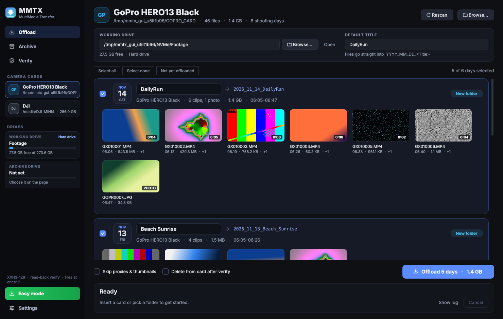
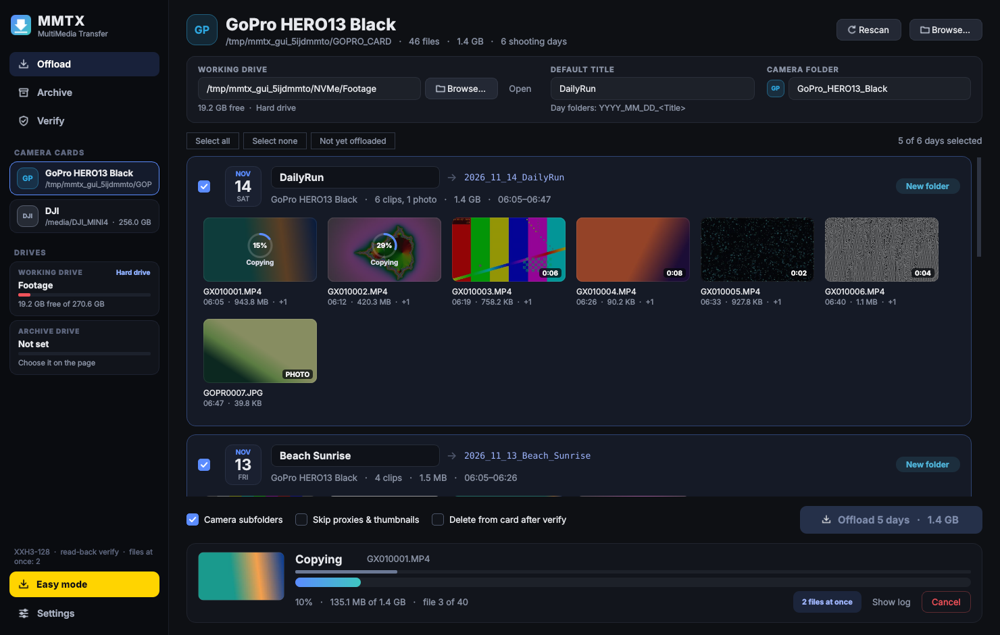
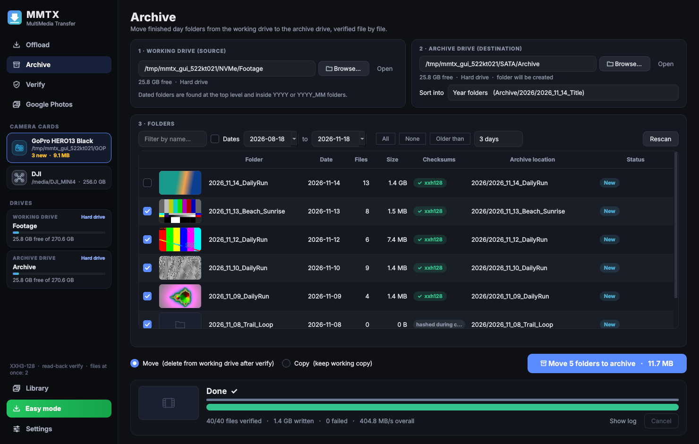

# MMTX · MultiMedia Transfer

A desktop app for getting footage off camera cards and onto archive drives without ever wondering if a file made it. Every file is checksummed on the way in, read back from the destination disk, and compared. If MMTX says it's done, it's bit-perfect.

Inspired by [mmt](https://github.com/konradit/mmt) and [GPTransfer](https://github.com/omokage-code/GPTransfer). See [Acknowledgements](#acknowledgements).



| Live transfer | Archive | Verify |
|---|---|---|
|  |  |  |

*(Screenshots use generated test clips.)*

## What it does

| Page | From → To | Grouped by |
|---|---|---|
| **Offload** | SD card / camera → working drive (NVMe) | **Shooting date** → `YYYY_MM_DD_<Title>` folders, with a thumbnail of every clip |
| **Archive** | Working drive → archive drive (SATA) | **Folder**, sorted into `Archive/YYYY/` (or `YYYY/YYYY_MM/`, or flat) |
| **Verify** | Any folder or a whole archive drive | Re-reads everything and compares against the recorded checksums |

## Quick start

**Windows:** double-click `run_mmtx.bat`. First launch creates a local `.venv` and installs PySide6, xxhash and imageio-ffmpeg (needs Python 3.10+).

**Linux / macOS:** `./run_mmtx.sh`

**Or:** `pip install .` and then run `mmtx`

**Standalone .exe (no Python on the target PC):** run `build_exe.bat`, which produces `dist\MMTX\MMTX.exe` (ffmpeg for thumbnails is bundled).

## Daily workflow

1. **Plug in the card.** It shows up in the sidebar within a few seconds and Offload opens it: one card per shooting day, with a thumbnail, duration and time for every clip. Days that aren't on the working drive yet are pre-selected. Clips already on the working drive carry a hollow green check. Double-click a tile to play the clip.
2. **Set titles.** The default title (e.g. `DailyRun`) fills every day. Type in a day's title box to change just that day (`Beach Sunrise` → `2026_11_13_Beach_Sunrise`). If a folder for that date already exists on the working drive, its title is picked up automatically and new files merge into it.
3. **Click Offload.** Each tile shows a progress ring while it copies and verifies, then a solid green check. The transfer bar shows the clip in flight. The summary lists copied / already there / failed, plus copy and read-back speeds.

When you're done editing:

4. **Archive** → pick the working drive and the archive drive → **Older than 30 days** (or tick folders, or filter by date range) → **Move to archive**. Each folder is copied, verified against both its fresh hash and the checksum recorded at offload, and only then removed from the working drive.

Months later: **Verify** → point it at the archive drive → **Verify checksums**. You get a per-folder report: bit-perfect, rotted, missing.

## Speed: why not always copy 4 files at once?

Copying several files at once only helps when the drives have headroom a single stream doesn't use. The time goes into two passes over the destination: writing every byte, then reading every byte back to verify it. Hashing isn't the bottleneck (XXH3 runs at ~15 GB/s per core and releases the GIL).

| Route | Bottleneck | Parallel effect |
|---|---|---|
| SD card → NVMe | The card (90-300 MB/s). NVMe read-back is ~10x faster | 2 at once hides the read-back behind the next copy: small win |
| NVMe → SATA SSD | SATA link (~550 MB/s) is shared by the write *and* the read-back | Little to gain; the link is already full |
| NVMe → hard drive | Seek time | **Slower**: the heads bounce between files and files fragment |
| NVMe → NVMe | Nothing much | Real win: read-back fully overlaps writing |
| Lots of small files (photos, LRV/THM/SRT) | Per-file overhead (create, fsync) | Real win on flash |

So **Files at once = Auto** (Settings) detects the drive types (Windows: bus type + seek penalty; Linux: `/sys/block`; macOS: `diskutil`) and picks:

- **1** if either side is a hard drive, a USB drive of unknown type, or can't be identified
- **2** from an SD card or USB reader to flash
- **3** between flash drives

The working and archive drive tiles in the sidebar show what was detected. You can force 1-4 in Settings.

After every transfer the summary shows **Copy speed per file** and **Read-back speed per file** next to the overall speed, so you can see which pass is the limit on your hardware. To measure your own drives directly:

```
python tests/bench.py D:\bench_src F:\bench_dst
```

Measured in the build VM (cloud SSD, so treat these as relative):

| | 1 at once | 2 | 3 | 4 |
|---|---|---|---|---|
| 6 × 256 MB clips | 1.00x | 1.23x | 1.29x | 1.24x |
| 1500 × 64 KB files | 1.00x | 1.33x | 1.47x | 1.56x |

## Thumbnails

Thumbnails are generated in the background, cheapest source first:

1. Sony's ready-made `THMBNL/C0001T01.JPG` (640×360)
2. A keyframe from the low-res proxy: GoPro / Insta360 `.LRV`, DJI `.LRF`, Sony `SUB/…S03.MP4`
3. A keyframe from the full clip (keyframe-only decode, so even 5.3K HEVC is quick)
4. GoPro `.THM`, photos directly, RAW files via their embedded preview JPEG

Durations are read straight from the MP4 header. Thumbnails are cached on disk (`%LOCALAPPDATA%\MMTX\cache`), so reopening a card is instant. They pause automatically while a transfer runs, so they never compete with the copy for the card. Video frames use ffmpeg from your PATH or the bundled `imageio-ffmpeg`. Without ffmpeg, tiles fall back to the camera's own thumbnails or a placeholder. Turn thumbnails off in Settings if you want.

## Folder layout

```
D:\Footage\  (working drive)                F:\Archive\  (archive drive, "Year folders")
  2026_11_14_DailyRun\                        2026\
    GoPro_HERO13_Black\                         2026_11_09_DailyRun\
      GX010001.MP4  GL010001.LRV  ...           2026_11_13_Beach_Sunrise\
    DJI\                                          GoPro_HERO13_Black\ ...
      DJI_20261114063012_0002_D.MP4 .LRF .SRT     Beach_Sunrise.prproj   <- edit files come along
    Insta360_X4\                                  _mmtx_checksums.xxh128
      VID_20261114_062000_00_001.insv ...
    Sony_FX3\
      C0001.MP4  C0001M01.XML  C0001S03.MP4
    _mmtx_checksums.xxh128
```

Camera subfolder names are editable on the Offload page and remembered per camera (rename `DJI` to `Mini4Pro` once and it sticks). Turn off **Camera subfolders** to drop everything flat into the day folder.

## Supported cameras

| Camera | Card layout recognized | Shooting date comes from |
|---|---|---|
| **GoPro** HERO / MAX | `DCIM/1xxGOPRO`: MP4, LRV, THM, JPG, GPR, WAV, 360 | File timestamp. Model read from `MISC/version.txt` |
| **DJI** drones, Osmo Action / Pocket / 360 | `DCIM/DJI_001`, `DCIM/100MEDIA`, `PANORAMA`: MP4, LRF, SRT, JPG, DNG, OSV | Timestamp in the filename (`DJI_YYYYMMDDhhmmss_…`), else file time |
| **Insta360** X-series, GO, Ace | `DCIM/Camera01`: insv, insp, lrv, mp4, dng | Timestamp in the filename. Model sniffed from the `.insv` |
| **Sony** FX3 / FX30 / A7S III / any XAVC body | `PRIVATE/M4ROOT/CLIP` (+ `M01.XML`), `SUB` proxies, `THMBNL`, `DCIM/100MSDCF` | `CreationDate` in the XML sidecar (ignores a wrong file clock). Model from the XML |
| **Anything else** | Media files anywhere on the card | File timestamp (Pixel `PXL_` names parsed) |

A clip's proxy, thumbnail and sidecar always land on the same day as the clip, even when recording runs past midnight. Camera junk (`MISC`, `MEDIAPRO.XML`, `STATUS.BIN`, log files) is ignored.

## How verification works

1. Each file is copied to `name.mmtx-partial` while the **source stream is hashed** (XXH3-128 by default).
2. The copy is fsync'd and **evicted from the OS cache** (Linux `posix_fadvise`, macOS `F_NOCACHE`, Windows unbuffered `FILE_FLAG_NO_BUFFERING` read), so the next step reads the actual disk rather than RAM.
3. The destination is **read back and hashed**. A match renames it to its final name. A mismatch deletes it, retries once, then marks the file as failed.
4. A manifest `_mmtx_checksums.xxh128` is written at the root of every day / archive folder. It uses the standard `hash  path` format, so `xxh128sum -c` (or `sha256sum -c` if you pick SHA-256) also works without MMTX.
5. On **archive**, the source hash is also compared to the manifest from offload. That catches corruption that happened on the working drive in between. Folders where that happens are copied but **kept** on the working drive and flagged.

With several files in flight, output names are reserved under a lock, so two card files with the same name (e.g. from `100GOPRO` and `101GOPRO`) can never collide. A full disk or a pulled card stops every worker at its next chunk and cleans up their partial files.

## Safety rules

- **Cards are read-only** unless you tick *Delete from card after verify*. Even then, only days where every file verified are touched.
- **Nothing is overwritten.** If the same name already exists and its checksum matches, the file is skipped and counted as verified (this is how re-running an interrupted offload resumes). If the same name holds different content, the new file is saved as `name_1.ext`.
- **Move = copy + verify + delete.** A folder is removed from the source only after every file in it verified.
- Archive moves on the **same physical drive** are an instant rename.
- **Cancel / pulled card:** in-flight `.mmtx-partial` files are removed. Completed files stay verified and in the manifest, so the next run resumes.
- Checks for **free space** and the **FAT32 4 GB file limit** before starting.
- **Camera timestamps are preserved** on every copied file. Read-only attributes are not carried over.
- Every job writes a full log (Settings → Logs → Open).

## Settings

- **Checksum:** XXH3-128 (default), XXH64, SHA-256, MD5. Folders that already have a manifest keep its algorithm.
- **Read-back verify:** on by default. Turning it off still records source checksums (for later Verify runs) but only checks the destination size. Roughly halves the time on slow archive drives.
- **Bypass OS cache on read-back:** on by default.
- **Files at once:** Auto (by drive type) or 1-4.
- **Spaces → underscores** in titles (`Morning Run` → `2026_11_14_Morning_Run`).
- **Keep card folder structure** (for Sony Catalyst Browse, which wants `PRIVATE/M4ROOT/…`).
- **Rename GoPro chapters** so they sort together: `GX010123.MP4` → `GX0123_01.MP4`.
- **Thumbnails** on/off.

## Notes

- **USB connections:** cameras that connect over USB as MTP (several GoPro models, phones) don't appear as a drive. Use a card reader. Insta360 X-series and DJI drones in USB storage mode work fine.
- **Sony cards:** deleting clips outside the camera leaves its clip database out of sync (the camera will offer to repair it). Formatting in camera is cleaner, so *Delete from card* is off by default.
- Network shares are never auto-listed as cards, but you can still Browse to one as a destination.
- To rename the app, change `APP_NAME` in `mmtx/__init__.py`.

## Tests

```
python tests/test_engine.py           # offload, resume, corruption, conflicts, cancel, archive, bit rot, verify, parallel
python tests/test_media.py            # durations, ffmpeg keyframes (H.264 + HEVC), RAW previews
python tests/gui_smoke.py shots/      # drives the real window headless end to end and saves screenshots
python tests/bench.py SRC_DIR DST_DIR # files-at-once benchmark on your own drives
python tests/make_fake_cards.py out/  # fake GoPro / DJI / Insta360 / FX3 cards to play with
```

Set `MMTX_TEST_WORKERS=3` to run the engine suite with 3 files in flight.

## Layout

```
mmtx/
  hashing.py     checksums + cache-bypassing readers (Linux / macOS / Windows)
  manifest.py    _mmtx_checksums.* read / write (xxhsum / sha256sum compatible)
  transfer.py    parallel copy -> read-back verify -> rename engine, move/delete rules, Verify + Create-checksum runners
  drives.py      NVMe / SSD / HDD / SD detection and the Auto files-at-once policy
  media.py       MP4 durations, ffmpeg keyframe grabs, RAW previews, thumbnail source picking
  cameras.py     GoPro / DJI / Insta360 / Sony detection, roles, capture dates, models
  scanner.py     card scan grouped by day; working-drive scan of YYYY_MM_DD_<Title> folders
  planner.py     scans + choices -> jobs; folder naming; archive layouts
  settings.py    JSON settings in %APPDATA%\MMTX (Windows), ~/.config/mmtx (Linux)
  ui/            sidebar, Offload day cards + clip grid, Archive, Verify, transfer bar, dialogs, theme, icons
```

## Acknowledgements

MMTX is written from scratch in Python and contains no code from either project below. The idea and several design choices come from them, though, so credit where it's due:

- **[mmt (Media Management Tool)](https://github.com/konradit/mmt)** by [KonradIT](https://github.com/KonradIT), Apache-2.0. A Go command-line tool for importing videos and photos from GoPro, Insta360 and DJI cameras: it renames and organizes files, groups related shots, merges GoPro chaptered videos and sorts media into folders by camera. MMTX's per-camera card detection, folder-per-camera layout and the GoPro chapter-renaming option follow its lead, and the name is a nod to it.
- **[GPTransfer](https://github.com/omokage-code/GPTransfer)** by [omokage-code](https://github.com/omokage-code), MIT. A macOS app for safely transferring GoPro files to a Mac. It treats camera files as read-only, writes incomplete transfers to `.partial` files and verifies before finalizing. MMTX's read-only card handling and `.mmtx-partial` files follow that model, extended with checksums and read-back verification, and its GUI-first approach is why MMTX is a desktop app rather than a CLI.

Built with:

- [Qt for Python (PySide6)](https://doc.qt.io/qtforpython-6/) for the interface
- [xxHash](https://github.com/Cyan4973/xxHash) by Yann Collet, via [python-xxhash](https://github.com/ifduyue/python-xxhash), for checksums
- [FFmpeg](https://ffmpeg.org/), via [imageio-ffmpeg](https://github.com/imageio/imageio-ffmpeg), for video thumbnails
- [PyInstaller](https://pyinstaller.org/) for the standalone build

Each is under its own license. The standalone `.exe` bundles the Qt and FFmpeg binaries, so if you hand it to anyone else, include their license notices with it.
